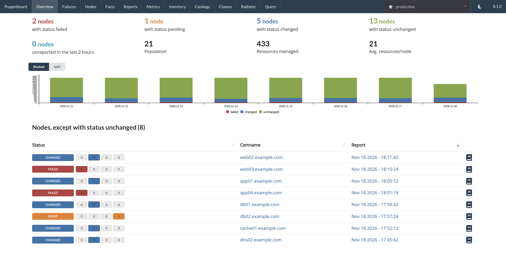
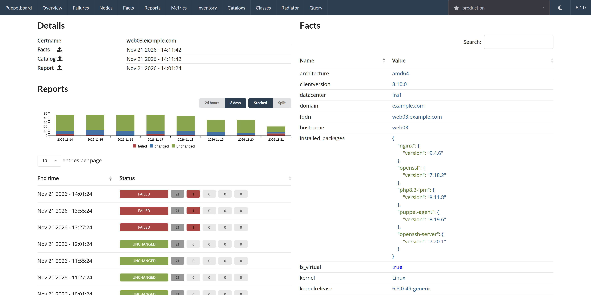
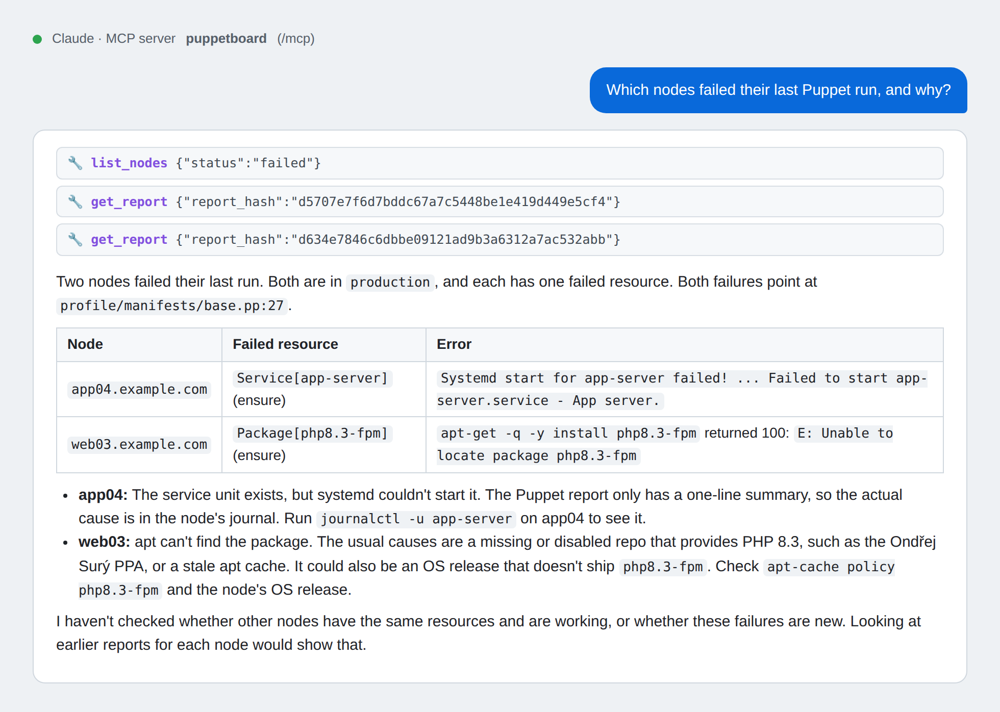
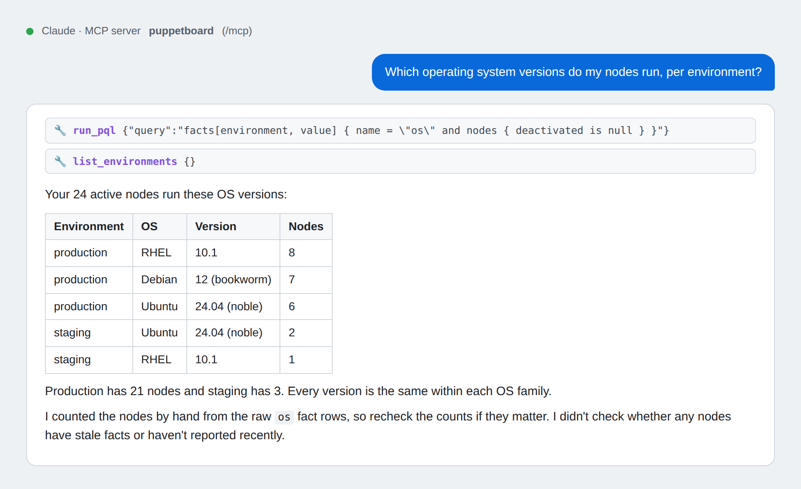
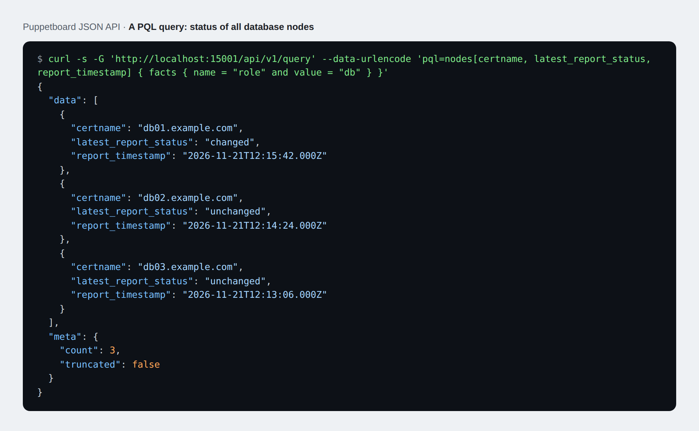

<p align="center"></p>

# Puppetboard

[](https://pypi.org/project/puppetboard-dp/)


A web interface to [PuppetDB](https://puppet.com/docs/puppetdb/latest/index.html) for open source Puppet:
which nodes failed, changed or stopped reporting, what each Puppet run did, and which facts your nodes have.

This is a fork of [voxpupuli/puppetboard](https://github.com/voxpupuli/puppetboard) by
[Vox Pupuli](https://voxpupuli.org). It adds a **read-only JSON API** and an **MCP server for AI assistants**,
runs on ASGI only, keeps its dependencies current and ships a hardened container image, a Helm chart and
Compose examples.



## What this fork adds

- **Read-only JSON API** under `/api/v1/` (`ENABLE_API`): nodes, facts, reports, catalog resources and PQL
  queries, `GET` only, described as OpenAPI 3.1 at `/api/v1/openapi.json` and browsable at `/api/v1/docs`.
  [docs/API.md](docs/API.md#json-api)
- **MCP server** under `/mcp` (`ENABLE_MCP`): Claude and other MCP clients read nodes, facts, reports and
  catalog resources. Thirteen read-only tools that discover your facts first, so no fact of its own is needed.
  [docs/MCP.md](docs/MCP.md)
- **Built along the CIS benchmarks:** API and MCP follow the CIS API Security Guide and the CIS MCP Server
  Benchmark: every parameter validated, paging and result limits, rate limit, audit log, DNS rebinding
  protection for `/mcp`. Authentication belongs in the reverse proxy in front.
  [docs/API.md](docs/API.md#securing-api-and-mcp)
- **One package, one entry point:** `pip install puppetboard-dp` brings gunicorn and the MCP dependencies;
  `gunicorn -k asgi puppetboard.asgi:app` serves web interface, API and MCP. WSGI is gone.
- **Hardened container image** `ghcr.io/dennispohlmann/puppetboard`: official `python:3.15-alpine` pinned by
  digest, no compiler and no pip, unprivileged user (uid 10001), port 8080.
- **Kubernetes and Compose:** a [Helm chart](charts/puppetboard/) released as
  `oci://ghcr.io/dennispohlmann/charts/puppetboard`, and [docker-compose examples](docker-compose/) for
  Puppetboard alone or behind nginx with TLS and Basic-Auth.
- **Ready for RHEL:** Python 3.12 is enough (the system Python of RHEL 10); a systemd unit, SELinux labels
  and nginx or Apache in front are in [docs/Deployment-setups.md](docs/Deployment-setups.md).
- **Security fixes:** stored and reflected XSS through node data and URL parameters closed on every page;
  forged audit log lines and spoofed client addresses for the rate limit prevented.
- **Run times on the overview:** charts of the fastest, slowest and average catalog application and fact
  generation time per day, and a switch for all overview charts between the last 24 hours and the last days.
- **Faster with many nodes:** quicker facts overview, failures, inventory, nodes and daily chart; the
  environment list is cached for 60 seconds.
- **Current libraries:** DataTables, Fomantic-UI, jQuery, billboard.js and the Python dependencies kept up
  to date; Python 3.12 to 3.15.

Everything Puppetboard already does stays: overview, nodes, reports, failures, facts with charts, query page
with saved presets, metrics, inventory, classes, a radiator for wall displays, offline mode and dark mode.
The full list of changes is in the [CHANGELOG](CHANGELOG.md).

## Screenshots

**Single node with its reports**



**Failures: the errors of all failing nodes**


**A fact with its chart**


**MCP server: real questions from Claude, answered from PuppetDB** ([docs/MCP.md](docs/MCP.md))






**JSON API: real `curl` calls and their answers** ([docs/API.md](docs/API.md#examples))




All views: [docs/Screenshots.md](docs/Screenshots.md).

## Requirements

- PuppetDB 5.2 to 8.x (not 8.1.0 because of [this bug](https://github.com/puppetlabs/puppetdb/issues/3866),
  use 8.1.1 or newer), with the Puppet Server
  [storing its reports in PuppetDB](https://puppet.com/docs/puppetdb/latest/connect_puppet_server.html)
- Docker or Podman, Kubernetes with Helm, or Python 3.12 to 3.15
- A reverse proxy with TLS in front; with API or MCP enabled it must also authenticate clients

## Quick start

On the PuppetDB host, with the container image:

```bash
docker run -d --name puppetboard --net=host \
  -e PUPPETDB_HOST=localhost -e PUPPETDB_PORT=8080 \
  -e PUPPETBOARD_PORT=8088 \
  -e SECRET_KEY="$(openssl rand -hex 32)" \
  ghcr.io/dennispohlmann/puppetboard
```

Then open `http://localhost:8088`. With `--net=host` next to PuppetDB, `PUPPETBOARD_PORT` must differ from
PuppetDB's port 8080.

From PyPI, in a virtual environment (the package is `puppetboard-dp`, the module is still `puppetboard`):

```bash
python3 -m venv /opt/puppetboard
/opt/puppetboard/bin/pip install puppetboard-dp
PUPPETBOARD_SETTINGS=/etc/puppetboard/settings.py \
  /opt/puppetboard/bin/gunicorn -k asgi -b 127.0.0.1:8080 puppetboard.asgi:app
```

On Kubernetes, for an existing PuppetDB (certificate Secret and all values:
[charts/puppetboard](charts/puppetboard/README.md)):

```bash
helm install puppetboard oci://ghcr.io/dennispohlmann/charts/puppetboard \
  --namespace puppetboard --create-namespace \
  --set secretKey="$(openssl rand -hex 32)" \
  --set puppetdb.host=puppetdb.example.com \
  --set puppetdb.tls.existingSecret=puppetboard-puppetdb-tls
```

With Compose, for Puppetboard alone or behind nginx with TLS and Basic-Auth: [docker-compose/](docker-compose/).

To turn on the JSON API and the MCP server, add `ENABLE_API=true`, `ENABLE_MCP=true` and
`MCP_ALLOWED_HOSTS=puppetboard.example.com` (your host name). Both have **no authentication of their own**,
so put a TLS reverse proxy with authentication in front, see
[Securing API and MCP](docs/API.md#securing-api-and-mcp).

## Configuration

Outside the container Puppetboard reads a Python file named by `PUPPETBOARD_SETTINGS` that overrides only
what differs from [default_settings.py](puppetboard/default_settings.py); the container image, the Helm
chart and Compose take the same names as environment variables. On the PuppetDB host the defaults are
enough. Elsewhere set at least `PUPPETDB_HOST`, `PUPPETDB_PORT` and the client certificate
(`PUPPETDB_SSL_VERIFY`, `PUPPETDB_KEY`, `PUPPETDB_CERT`), and always a `SECRET_KEY`.

Every setting: [docs/Configuration.md](docs/Configuration.md).

## Documentation

| File | Content |
|---|---|
| [docs/Configuration.md](docs/Configuration.md) | all settings, PuppetDB certificates, Puppet agent and PuppetDB configuration |
| [docs/Deployment-setups.md](docs/Deployment-setups.md) | container, Puppet-managed container, pip with gunicorn and systemd, SELinux on RHEL, nginx and Apache in front |
| [docs/API.md](docs/API.md) | JSON API endpoints, securing API and MCP, CIS benchmark coverage |
| [docs/MCP.md](docs/MCP.md) | MCP server, its settings and tools, example questions |
| [docker-compose/](docker-compose/) | Compose examples: `standalone` and `proxy` (nginx with TLS and Basic-Auth) |
| [charts/puppetboard/](charts/puppetboard/README.md) | Helm chart: install from ghcr.io, PuppetDB certificate, all values |
| [QUERY_PRESETS.md](QUERY_PRESETS.md) | saved queries on the Query page |
| [docs/Screenshots.md](docs/Screenshots.md) | every view |
| [docs/Development.md](docs/Development.md) | local development, tests, commit messages |
| [RELEASE.md](RELEASE.md) | how a release is built |
| [CHANGELOG.md](CHANGELOG.md) | changes per version, including the upstream history |
| [.github/SECURITY.md](.github/SECURITY.md) | security policy, how to report a vulnerability |
| [THIRD_PARTY.md](THIRD_PARTY.md) | bundled third-party files and their licenses |

## Getting help

Questions and bug reports go to the [issues](https://github.com/DennisPohlmann/puppetboard/issues).
Security problems please report privately, see [SECURITY.md](.github/SECURITY.md).

## License and credits

Puppetboard is licensed under the [Apache License, Version 2.0](LICENSE). Bundled third-party files and their
licenses are listed in [THIRD_PARTY.md](THIRD_PARTY.md).

The original Puppetboard is developed by [Vox Pupuli](https://voxpupuli.org) at
[voxpupuli/puppetboard](https://github.com/voxpupuli/puppetboard); this fork builds on their work.
It relies on [pypuppetdb](https://pypi.org/project/pypuppetdb/) and [Flask](https://flask.palletsprojects.com).

The favicon has been created based on the icon created by [ShellyCoen](https://github.com/ShellyCoen/) under the
[Creative Commons Attribution-ShareAlike 4.0 International License](http://creativecommons.org/licenses/by-sa/4.0/),
downloaded from the [voxpupuli/logos](https://github.com/voxpupuli/logos), resized and centered.
