# Puppetboard

[](https://pypi.org/project/puppetboard-dp/)


This is a fork of [voxpupuli/puppetboard](https://github.com/voxpupuli/puppetboard) by [Vox Pupuli](https://voxpupuli.org)
with a read-only JSON API, an MCP server for AI assistants, current dependencies and a hardened container image.

Puppetboard is a web interface to [PuppetDB](https://puppet.com/docs/puppetdb/latest/index.html) aiming to replace
the reporting functionality of [Puppet Enterprise console (previously: Puppet Dashboard)](https://puppet.com/docs/pe/latest/console_accessing.html)
for the open source Puppet.


See [more screenshots here](#more-screenshots).

## Table of Contents

* [Requirements](#requirements)
* [Installation](#installation)
* [Configuration](#configuration)
* [Getting Help](#getting-help)
* [Contributing](#contributing)
* [Legal](#legal)

## Requirements<a id="requirements"></a>

* PuppetDB v. 5.2-8.*
  * (**Note**: PuppetDB 8.1.0 is not supported because of [this bug](https://github.com/puppetlabs/puppetdb/issues/3866). Please update to 8.1.1+.)
* Python 3.12-3.15 or Docker

## Installation<a id="installation"></a>

This fork is available on PyPI as `puppetboard-dp` and as container image `ghcr.io/dennispohlmann/puppetboard`.

### Using Docker

The container image of this fork is published in the
[GitHub Container Registry](https://github.com/DennisPohlmann/puppetboard/pkgs/container/puppetboard)
as `ghcr.io/dennispohlmann/puppetboard`.

You can run the app on your PuppetDB host with this command:

```bash
docker run -it \
  -e PUPPETDB_HOST=localhost \
  -e PUPPETDB_PORT=8080 \
  -e PUPPETBOARD_PORT=8088 \
  -e SECRET_KEY=XXXXXXXX \
  --net=host \
  ghcr.io/dennispohlmann/puppetboard
```
With `--net=host` next to PuppetDB, `PUPPETBOARD_PORT` must differ from PuppetDB's port 8080.
Note: you must provide a secret key! Generate one for example by running `ruby -e "require 'securerandom'; puts SecureRandom.hex(32)"`.

The image is based on the official `python:3.15-alpine` image, pinned by digest, without compiler and pip. It runs as the unprivileged user `puppetboard` (uid 10001) and listens on
port **8080** (`PUPPETBOARD_PORT`).

Optionally you can set `PUPPETBOARD_URL_PREFIX` env variable to a value like `/puppetboard` to run the app under a URL prefix.

Ready-made [docker-compose examples](docker-compose/) cover Puppetboard alone and behind nginx with TLS and
Basic-Auth.
For Kubernetes there is a [Helm chart](charts/puppetboard/), released as `oci://ghcr.io/dennispohlmann/charts/puppetboard`.

The image can also serve a read-only JSON API (`-e ENABLE_API=true`) and an MCP server for AI assistants
(`-e ENABLE_MCP=true -e MCP_ALLOWED_HOSTS=puppetboard.example.com`). Both have no authentication of their own,
so put a TLS reverse proxy with authentication in front. See [docs/API.md](docs/API.md).

You can use the following Puppet Code to have Puppetboard managed by Puppet:

```puppet
include docker

docker::image { 'ghcr.io/dennispohlmann/puppetboard': }

docker::run { 'puppetboard':
  image => 'ghcr.io/dennispohlmann/puppetboard',
  env   => [
    'PUPPETDB_HOST=127.0.0.1',
    'PUPPETDB_PORT=8080',
    'PUPPETBOARD_PORT=8088',
    'SECRET_KEY=XXXXXXXX',
  ],
  net   => 'host',
}
```

If you want to have all features enabled, you must use SSL talking to PuppetDB:

```puppet
file { '/etc/puppetboard':
  ensure => directory,
}
file { '/etc/puppetboard/key.pem':
  ensure => file,
  mode   => '0644',
  source => "/etc/puppetlabs/puppet/ssl/private_keys/${facts['networking']['fqdn']}.pem",
}
file { '/etc/puppetboard/cert.pem':
  ensure => file,
  mode   => '0644',
  source => "/etc/puppetlabs/puppet/ssl/certs/${facts['networking']['fqdn']}.pem",
}

include docker

docker::image { 'ghcr.io/dennispohlmann/puppetboard': }

docker::run { 'puppetboard':
  image   => 'ghcr.io/dennispohlmann/puppetboard',
  volumes => ['/etc/puppetboard:/etc/puppetboard:ro'],
  env     => [
    'PUPPETDB_HOST=puppet', # this must be the certname or DNS_ALT_NAME of the PuppetDB host
    'PUPPETDB_PORT=8081',
    'PUPPETBOARD_PORT=8080',
    'ENABLE_CATALOG=true',
    'PUPPETDB_SSL_VERIFY=false',
    'PUPPETDB_KEY=/etc/puppetboard/key.pem',
    'PUPPETDB_CERT=/etc/puppetboard/cert.pem',
    'SECRET_KEY=XXXXXXXX',
    'DEFAULT_ENVIRONMENT=*',
  ],
  net     => 'host',
}
```

Within an air gapped environment you want to load all content from your local puppetboard web service.
Add: `'OFFLINE_MODE=true',` to the `env` parameter list of the `docker::run` Puppet type.

We also provide the Dockerfile, so you can build the image yourself:
```bash
docker build -t puppetboard .
```

### Manually

Install the package from PyPI into a virtual environment. It brings gunicorn and everything the MCP server
needs; the package to import and run is still `puppetboard`.

```bash
python3 -m venv /opt/puppetboard
/opt/puppetboard/bin/pip install puppetboard-dp
PUPPETBOARD_SETTINGS=/etc/puppetboard/settings.py \
  /opt/puppetboard/bin/gunicorn -k asgi -b 127.0.0.1:8080 puppetboard.asgi:app
```

`puppetboard.asgi:app` serves the web interface, the JSON API and the MCP server. The plain WSGI app
`puppetboard.app:app` (without MCP) works with any WSGI server. See [Deployment setups](docs/Deployment-setups.md)
for a systemd unit and a reverse proxy with authentication.

## Configuration<a id="configuration"></a>

### Puppet agents

The default value of `usecacheonfailure = true` configuration setting for Puppet agents causes Puppet runs to always succeed,
event if there are catalog compilation failures f.e. because of a syntax error in your code. This is because in such
cases with this setting Puppet will just use a cached working catalog and report the run to PuppetDB as successful.
(Although with an error visible in the Puppet run log.)

Therefore, to show the nodes with a catalog compilation as failed in Puppetboard you need to set
`usecacheonfailure = false` in your nodes' `puppet.conf`.

### PuppetDB

Of course you need to configure your Puppet Server to store the Puppet run reports in PuppetDB.
If you haven't done that already please follow the [PuppetDB documentation](https://puppet.com/docs/puppetdb/latest/connect_puppet_server.html)
about this.

If you run Puppetboard on a different host than PuppetDB then you may want to configure the certificate
allow-list for which certificates are allowed to access data from PuppetDB.
Please read more about this feature in the [PuppetDB documentation here](https://puppet.com/docs/puppetdb/latest/configure.html#certificate-allowlist).

### App settings

Puppetboard will look for a file pointed at by the `PUPPETBOARD_SETTINGS` environment variable.
The file has to be identical to
[default_settings.py](puppetboard/default_settings.py)
but should only override the settings you need changed.

If you run PuppetDB and Puppetboard on the same machine the default settings provided will be enough to get you started
and you won't need a custom settings file.

Assuming your webserver and PuppetDB machine are not identical you will at least have to change the following settings:

-   `PUPPETDB_HOST`
-   `PUPPETDB_PORT`

By default PuppetDB requires SSL to be used when a non-local client wants to connect. Therefore you'll also have to
supply the following settings:

-   `PUPPETDB_SSL_VERIFY = True`
-   `PUPPETDB_KEY = /path/to/private/keyfile.pem`
-   `PUPPETDB_CERT = /path/to/public/keyfile.crt`

When using the Puppetboard Docker image, you may also pass Puppetboard it's certificate contents via these environment
variables, either as a multiline string or pre-base64 encoded. This can be useful where the certificate is stored in a
secrets store i.e. AWS SSM Parameter Store.

```
PUPPETDB_CERT="-----BEGIN CERTIFICATE-----
...
-----END CERTIFICATE-----"
```

```
PUPPETDB_CERT=LS0tLS1CRUdJTiBSU0EgUFJJVkFURSBLRVktLS0tLQouLi4KLS0tLS1FTkQgQ0VSVElGSUNBVEUtLS0tLQ==
```

For information about how to generate the correct keys please refer to the
[pypuppetdb documentation](https://pypuppetdb.readthedocs.io/en/latest/connecting.html#ssl). Alternatively it is possible
to explicitly specify the protocol to be used setting the `PUPPETDB_PROTO` variable.

Other settings that might be interesting, in no particular order:

- `SECRET_KEY`: set this to a long string, **the same for each application replica**, and keep it secret. Refer to
    [Flask documentation](https://flask.palletsprojects.com/en/stable/quickstart/#sessions), section
    "How to generate good secret keys" for more info. Cannot be an empty string, which is the default.
- `FAVORITE_ENVS`: an ordered list of Puppet environment names that will be shown immediately after "All Environments"
    and before other environments (which are sorted by name) in the dropdown for choosing the environment shown
    in the top-right of the UI. Environments listed here that do not really exist in your deployment are silently ignored.
- `SHOW_ERROR_AS`: `friendly` or `raw`. The former makes Puppet run errors in Report and Failures views shown
    in a modified, (arguably) more user-friendly form. The latter shows them as they are.
    Defaults to `friendly`.
- `CODE_PREFIX_TO_REMOVE`: what code path that should be shortened in "Friendly errors" to "…" for readability.
    A regexp. Defaults to `/etc/puppetlabs/code/environments(/.*?/modules)?`.
- `PUPPETDB_TIMEOUT`: Defaults to 20 seconds, but you might need to increase this value. It depends on how big the
    results are when querying PuppetDB.
- `UNRESPONSIVE_HOURS`: The amount of hours since the last check-in after which a node is considered unresponsive.
- `LOGLEVEL`: A string representing the loglevel. It defaults to `'info'` but can be changed to `'warning'` or
    `'critical'` for less verbose logging or `'debug'` for more information.
- `ENABLE_QUERY`: Defaults to `True` causing a Query tab to show up in the web interface allowing users to write
    and execute arbitrary queries against a set of endpoints in PuppetDB. Change this to `False` to disable this.
    See `ENABLED_QUERY_ENDPOINTS` to fine-tune which endpoints are allowed. PQL (Query tab, `/api/v1/query`,
    MCP `run_pql`) can read every PuppetDB entity, catalogs and resource parameters included, also when
    `ENABLE_CATALOG` is `False`. Turn the query off if your catalogs hold secrets.
- `ENABLED_QUERY_ENDPOINTS`: If `ENABLE_QUERY` is `True`, allow to fine tune the endpoints of PuppetDB APIs that
    can be queried. It must be a list of strings of PuppetDB endpoints for which the query is enabled.
    See the `QUERY_ENDPOINTS` constant in the `puppetboard.forms` module for a list of the available endpoints.
- `QUERY_PRESETS_FILE`: Path to a YAML file with saved queries offered on the Query page, see
    [QUERY_PRESETS.md](QUERY_PRESETS.md). Defaults to `None` (no presets).
- `GRAPH_TYPE`: Specify the type of graph to display on fact pages. Default is `pie`, another good option is
    `donut`; the chart library is [billboard.js](https://naver.github.io/billboard.js/demo/).
- `GRAPH_FACTS`: A list of fact names to tell PuppetBoard to generate a pie-chart on the fact page. With some fact
    values being unique per node, like ipaddress, uuid, and serial number, as well as structured facts it was no longer
    feasible to generate a graph for everything.
- `INVENTORY_FACTS`: A list of tuples that serve as the column header and the fact name to search for to create
    the inventory page. If a fact is not found for a node then `undef` is printed.
- `INVENTORY_FACT_TEMPLATES`: A mapping between fact name and jinja template to customize display
- `ENABLE_CATALOG`: If set to `True` allows the user to view a node's latest catalog. This includes all managed
    resources, their file-system locations and their relationships, if available. Also gates catalog resources
    in the API and MCP server. Defaults to `False`.
- `REFRESH_RATE`: Defaults to `30` the number of seconds to wait until the index page is automatically refreshed.
- `DEFAULT_ENVIRONMENT`: Defaults to `'production'`, as the name suggests, load all information filtered by this
    environment value, for All Environments use `'*'`.
- `PAGE_TITLE`: Title of the browser window. Defaults to `Puppetboard`.
- `OVERVIEW_FILTER`: An extra PuppetDB query (pypuppetdb QueryBuilder) applied to the nodes on the Overview page.
    Defaults to `None`.
- `OFFLINE_MODE`: If set to `True` load static assets (jQuery, Fomantic-UI, DataTables, ...) from the local web server instead
    of a CDN. Defaults to `False`.
- `DAILY_REPORTS_CHART_ENABLED`: Enable the use of daily chart graphs when looking at dashboard and node view.
- `DAILY_REPORTS_CHART_DAYS`: Number of days to show history for on the daily report graphs.
- `DAILY_REPORTS_CHART_MODE`: Default layout of the daily report graphs, `'stacked'` or `'split'`.
- `DISPLAYED_METRICS`: Metrics to show when displaying node summary. Example: `'resources.total'`, `'events.noop'`.
- `TABLE_COUNT_SELECTOR`: Configure the dropdown to limit number of hosts to show per page.
- `LITTLE_TABLE_COUNT`: Default number of reports to show when when looking at a node.
- `NORMAL_TABLE_COUNT`: Default number of nodes to show when displaying reports and catalog nodes (container variable
    `REPORTS_COUNT`). Defaults to `100`.
- `LOCALISE_TIMESTAMP`: If set to `True` then timestamps are shown using your browser's timezone. Otherwise UTC is used. Defaults to `True`.
- `WITH_EVENT_NUMBERS`: If set to `True` then Overview and Nodes list shows exact number of changed resources
    in the last report. Otherwise shows only 'some' string if there are resources with given status. Setting this
    to `False` gives performance benefits, especially in big Puppet environments (more than few hundreds of nodes).
    Defaults to `True`.
- `ENABLE_API`: If set to `True` serves the read-only JSON API under `/api/v1/`. Defaults to `False`.
    See [docs/API.md](docs/API.md) for the endpoints and the `API_*` settings.
- `ENABLE_MCP`: If set to `True` serves a read-only MCP server under `/mcp` (ASGI entry point only).
    Needs `MCP_ALLOWED_HOSTS`. Defaults to `False`. See [docs/API.md](docs/API.md).
- `ENABLE_CLASS`: If set to `True` allows the user to view the number of resource events (number of changed resources in the last report) grouped by class.
    The resource events are grouped by their status ('failure', 'success', 'noop').
- `CLASS_EVENTS_STATUS_COLUMNS`: A mapping between the status of the resource events and the name of the columns of the table to display.
- `CACHE_TYPE`: Specifies which type of caching object to use when `SCHEDULER_ENABLED` is set to `True`.
    The cache is used for the classes view (`ENABLE_CLASS` is set to `True`) which requires parsing the events of all the latest reports to group them by Puppet class.
    If the last report is present in the cache, we do not parse the events, which avoids unnecessary processing.
    If you configure more than one worker, you must use a shared backend (e.g. `MemcachedCache`) to allow the sharing of the cache between the processes.
    Indeed, the `SimpleCache` type does not allow sharing the cache between processes, it uses the process memory to store the cache.
    Defaults to `SimpleCache`.
- `CACHE_DEFAULT_TIMEOUT`: Cache lifetime in second. Defaults to `3600`.
- `SCHEDULER_ENABLED`: If set to `True` then a scheduler instance is created in order to execute scheduled jobs. Defaults to `False`.
- `SCHEDULER_JOBS`: List of the scheduled jobs to trigger within a worker.
    A job can for example be used to compute a result to be cached. This is the case for the classes view which uses a job to pre-compute at regular intervals the results to be displayed.
    Each scheduled job must contain the following fields: `id`, `func`, `trigger`, `seconds`.
- `SCHEDULER_LOCK_BIND_PORT`: Specifies an available port that allows a single worker to listen on it.
    This allows to configure scheduled jobs in a single worker. Defaults to `49100`.

## Getting Help<a id="getting-help"></a>

For questions or bug reports you can file an [issue](https://github.com/DennisPohlmann/puppetboard/issues).
Security problems please report privately, see [SECURITY.md](.github/SECURITY.md).

## Contributing<a id="contributing"></a>

### Development

Puppetboard relies on the [pypuppetdb](https://pypi.org/project/pypuppetdb/) library to fetch data from PuppetDB
and is built with the help of the [Flask](https://flask.palletsprojects.com) microframework.

The recommended way to hack on Puppetboard is to:
1. clone the GitHub repository;
2. create a virtual environment;
```bash
$ python3 -m venv venv
$ . venv/bin/activate # run `deactivate` to exit the virtual environment
```
3. install the package and the test requirements.
```bash
$ pip install -r requirements-test.txt -e .
```

You can then run the tests with:
```bash
pytest --cov=. --cov-report=xml --strict-markers --mypy puppetboard test
pylint --errors-only puppetboard test
```

And you can run the app by executing:

```bash
$ export PUPPETBOARD_SETTINGS=$PWD/settings.py # see settings.py.sample
$ flask --app puppetboard.app run
```

Host and port can be set with `--host` and `--port`. Every change comes with matching unit tests.

### License

This project is licensed under the Apache v2.0 License. As such, your contributions, once accepted, are automatically
covered by this license. Bundled third-party files and their licenses are listed in [THIRD_PARTY.md](THIRD_PARTY.md).

### Commit messages

Write decent commit messages. Don't use swear words and refrain from uninformative commit messages as 'fixed typo'.

The preferred format of a commit message:

    Fixed a typo in the Nodes section.

    If needed, elaborate further on this commit. Feel free to write a
    complete blog post here if that helps us understand what this is
    all about.

    Fixes #4 and resolves #2.

If you'd like a more elaborate guide on how to write and format your commit messages have a look at [this post
by Tim Pope](https://tbaggery.com/2008/04/19/a-note-about-git-commit-messages.html).

### Build a release

please see: [RELEASE.md](RELEASE.md)

## More Screenshots<a id="more-screenshots"></a>

* Overview / Index / Homepage


* Nodes view, all active nodes

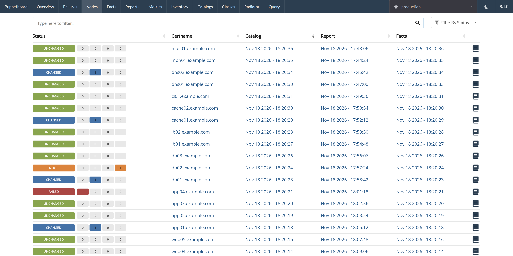

* Single node page / overview


* Report view

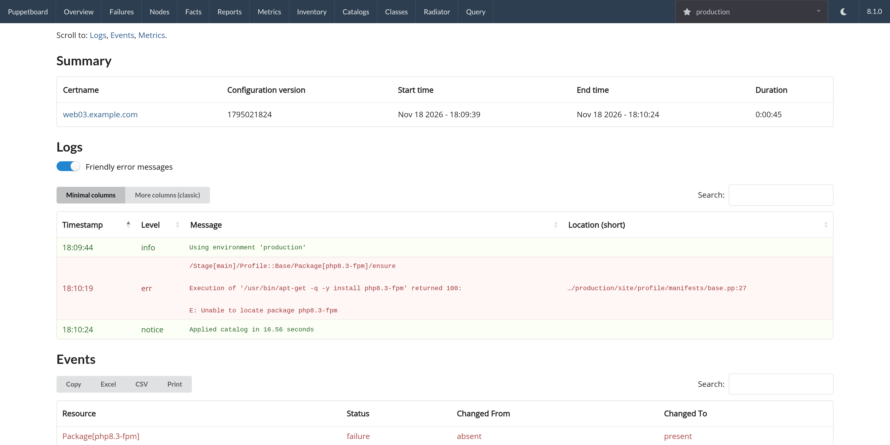

* Failures view, the errors of all failing nodes

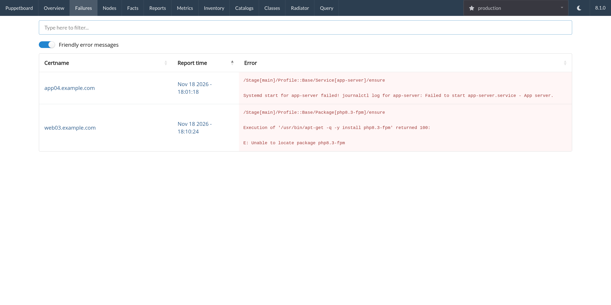

* Facts view

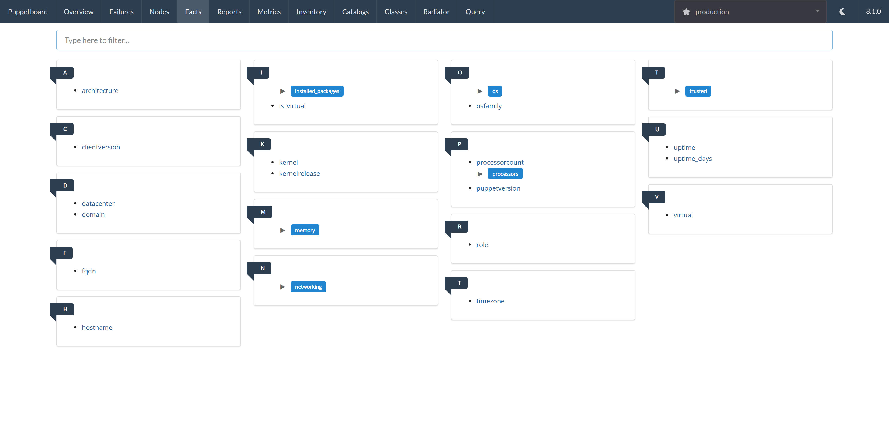

* Single fact, with graphs

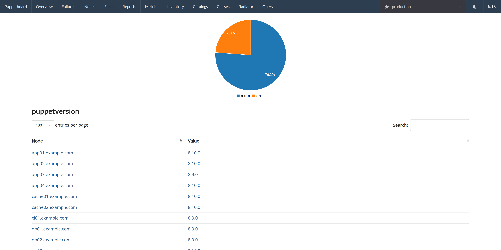

* All nodes that have this fact with that value

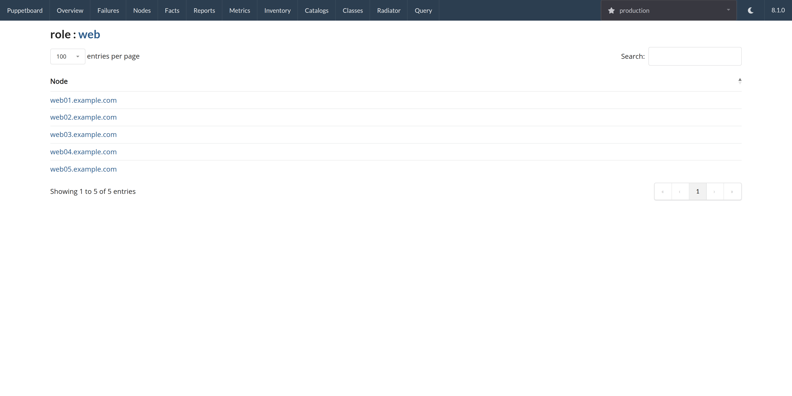

* Query view - results as table

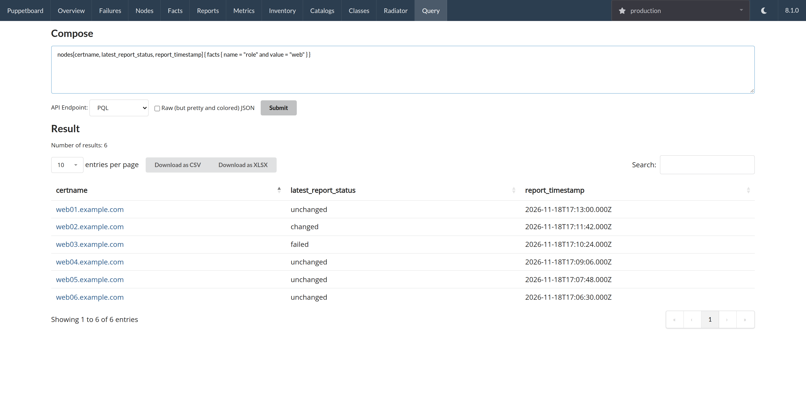

* Query view - results as JSON

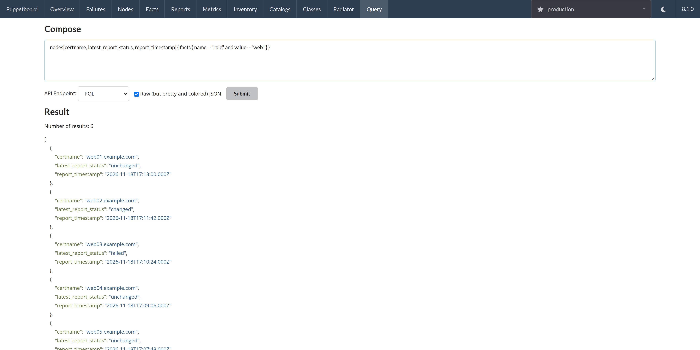

* Metrics view

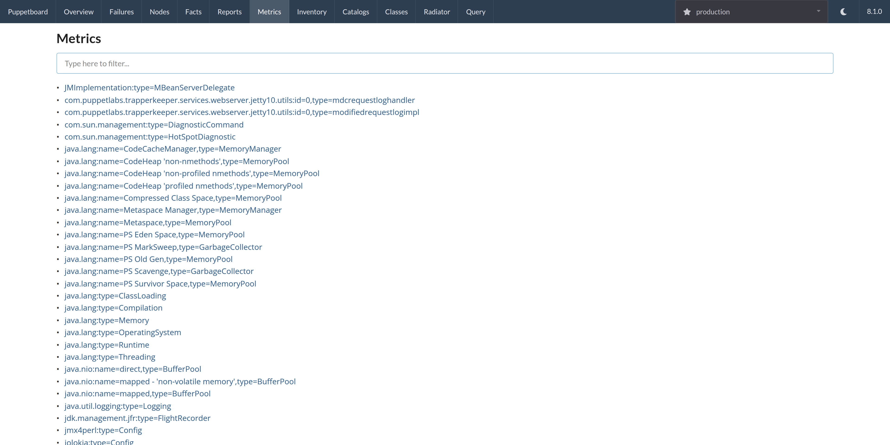

* Single metric

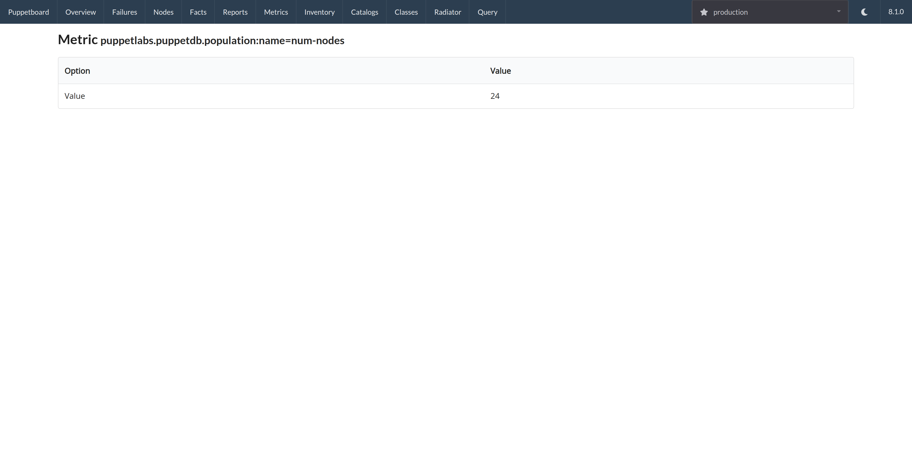

* Inventory view

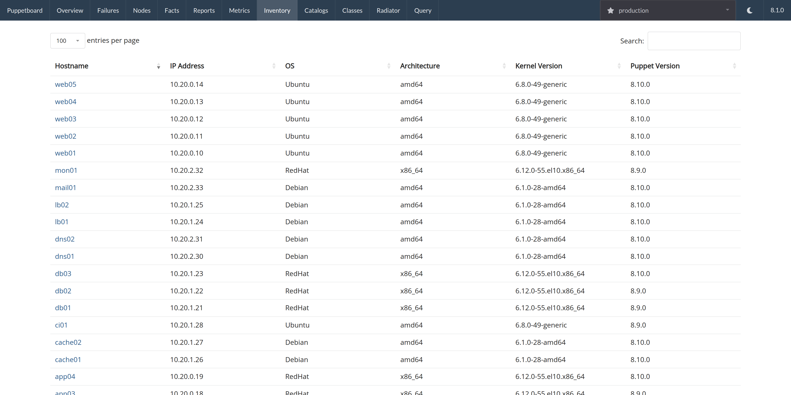

* Classes view, group the resource events of the last reports by Puppet class

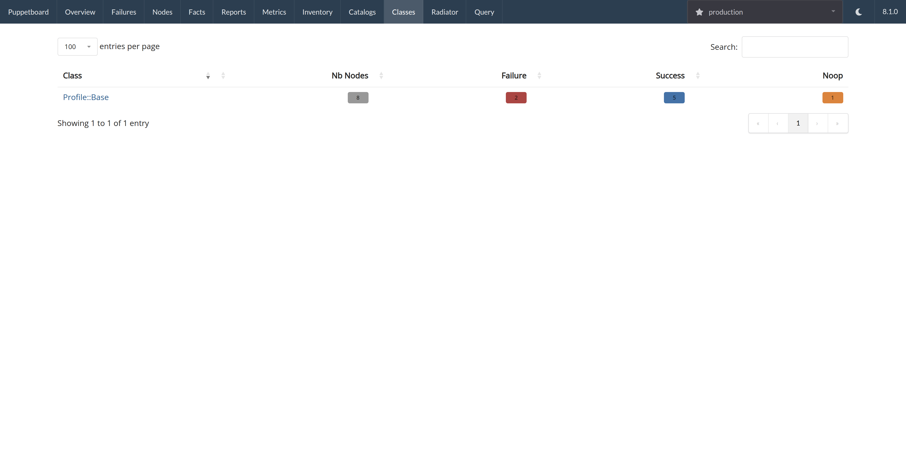

* Class view, list the nodes with almost one resource event for a given class

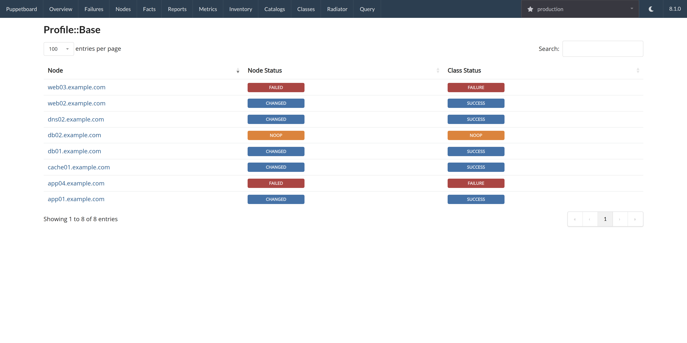

* Radiator view, for a wall display

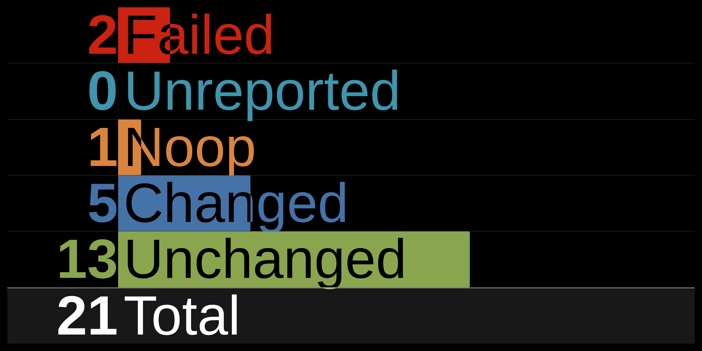

# Legal<a id="legal"></a>

The app code is licensed under the [Apache License, Version 2.0](./LICENSE).

The favicon has been created based on the icon created by [ShellyCoen](https://github.com/ShellyCoen/) under the [Creative Commons Attribution-ShareAlike 4.0 International License](http://creativecommons.org/licenses/by-sa/4.0/), downloaded from the [voxpupuli/logos](https://github.com/voxpupuli/logos), resized and centered.
