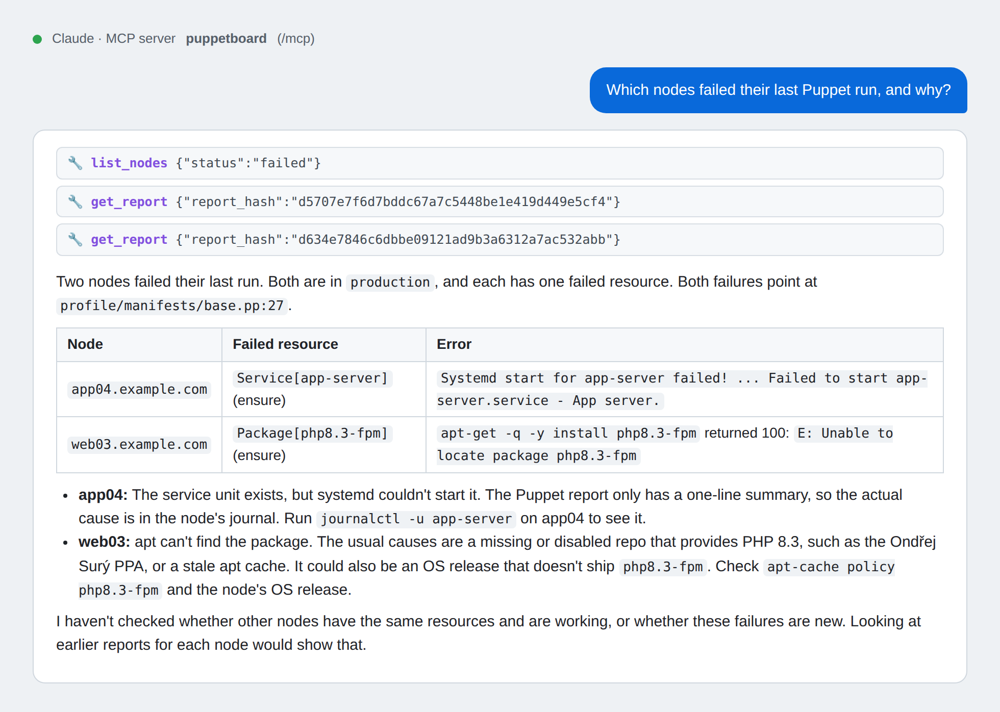
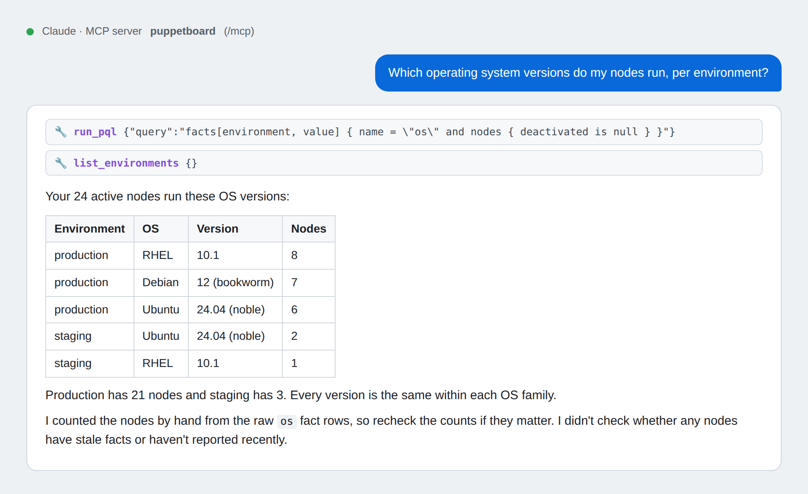
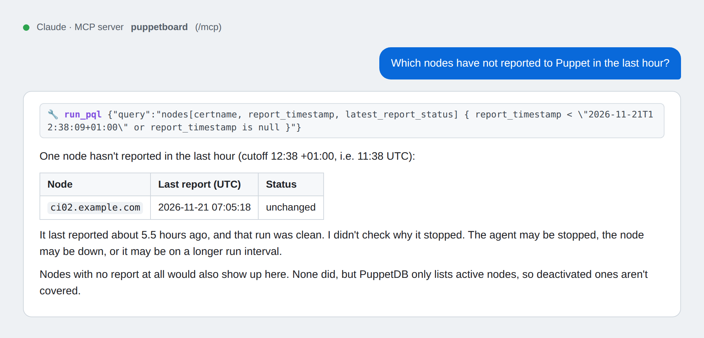

# MCP server

The MCP server lets AI assistants read your Puppet data: nodes and their
status, facts, reports and catalog resources. It speaks Streamable HTTP on
`/mcp` in stateless JSON mode (no SSE streams, no sessions) and is built on
the official Python MCP SDK.

It only runs when Puppetboard is served through the ASGI entry point, as the
container image does:

```bash
gunicorn -k asgi puppetboard.asgi:app
```

Outside the container `pip install puppetboard-dp` brings gunicorn and the MCP dependencies.

## MCP settings

| Setting | Docker variable | Default | Meaning |
|---|---|---|---|
| `ENABLE_MCP` | `ENABLE_MCP` | `False` | Serve `/mcp`. |
| `MCP_ALLOWED_HOSTS` | `MCP_ALLOWED_HOSTS` (comma separated) | empty | `Host` headers accepted on `/mcp`, e.g. `puppetboard.example.com`; `host:*` allows any port. Protects against DNS rebinding. Empty refuses every request. |
| `MCP_ALLOWED_ORIGINS` | `MCP_ALLOWED_ORIGINS` (comma separated) | empty | `Origin` headers accepted, e.g. `https://puppetboard.example.com`. Requests without `Origin` (normal MCP clients) are fine. |
| `MCP_MAX_REQUEST_BODY` | `MCP_MAX_REQUEST_BODY` | `65536` | Largest request body in bytes. |
| `MCP_PROTOCOL_VERSIONS` | `MCP_PROTOCOL_VERSIONS` (comma separated) | `2025-06-18,2025-11-25,2026-07-28` | Accepted `MCP-Protocol-Version` headers. |
| `API_RATE_LIMIT` | `API_RATE_LIMIT` | `120` | Same setting as for the API, requests per minute and client, counted separately for `/mcp`. |
| `ENABLE_QUERY` | `ENABLE_QUERY` | `True` | Offers the `run_pql` tool. |
| `ENABLE_CATALOG` | `ENABLE_CATALOG` | `False` | Offers the `list_node_resources` tool. |

## Tools

All tools are read-only and marked so (`readOnlyHint`).

| Tool | What it does |
|---|---|
| `get_current_time` | Current UTC time of the Puppetboard server, so the assistant can tell how old a run is. |
| `list_environments` | Puppet environments. |
| `list_nodes` | Active nodes with status, filter by `status` and `environment`. |
| `get_node` | Status and timestamps of one node. |
| `search_fact_names` | Top-level fact names containing a substring. |
| `search_fact_paths` | Paths into structured facts matching a regex, with value types. |
| `get_node_facts` | Facts of one node, optionally only some names. |
| `get_fact_values` | One top-level fact on all nodes. |
| `find_fact_values` | Values at a dotted fact path (`*` as wildcard element), optional value regex. |
| `list_node_reports` | Report summaries of a node, newest first. |
| `get_report` | One report with logs, metrics and events. |
| `list_node_resources` | Catalog resources of a node, e.g. type `package`, only with `ENABLE_CATALOG`. |
| `run_pql` | Any PQL query, only with `ENABLE_QUERY`. |

All timestamps are UTC as PuppetDB delivers them (`2026-11-21T12:30:00.000Z`),
whatever time zone the nodes run in. `start_time`, `end_time` and
`producer_timestamp` of a report come from the agent's clock, `receive_time`
from PuppetDB. A run "in the future" means that agent's clock is ahead.

Puppetboard does not add a fact of its own. Facts differ from site to site,
so the server tells the assistant to discover them first (`search_fact_names`,
`search_fact_paths`) and then query values. A question like "which nodes have
openssl 3.0 installed" works if some fact carries package versions, or via
catalog resources of type `package` for packages Puppet manages.

Example client configuration (Claude Code):

```bash
claude mcp add --transport http puppetboard https://puppetboard.example.com/mcp --header "Authorization: Basic $(printf user:pass | base64)"
```

## Examples

Real answers from Claude Code connected to `/mcp` of a test instance, with the tool calls it made.







## Securing

The MCP server has no authentication of its own. Put it behind a reverse proxy with TLS and authentication,
see [Securing API and MCP](API.md#securing-api-and-mcp) and the CIS MCP benchmark mapping there.
