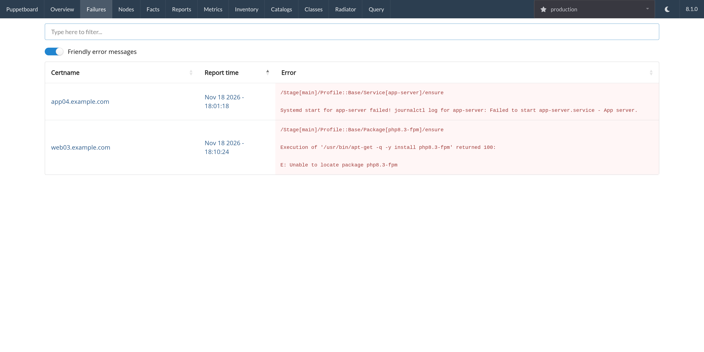
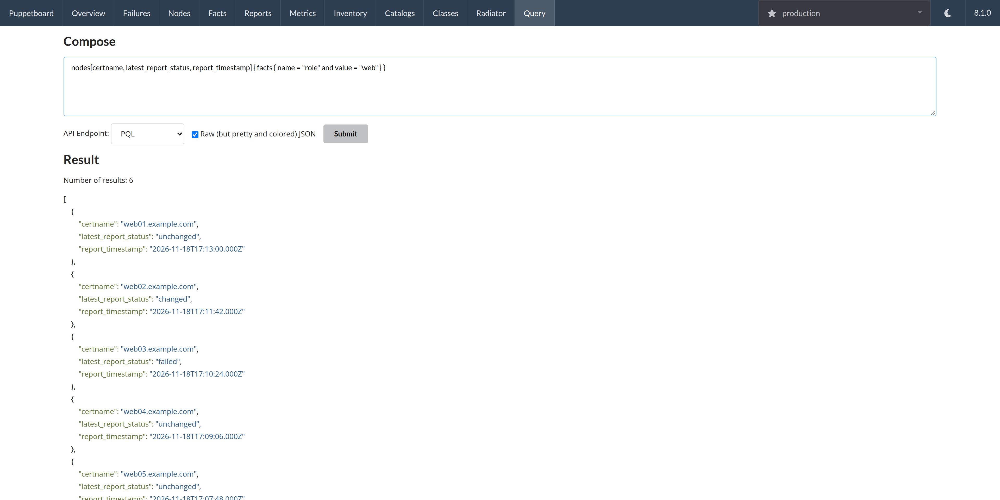
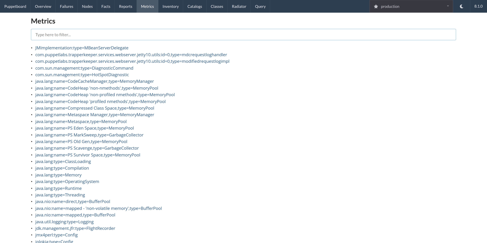
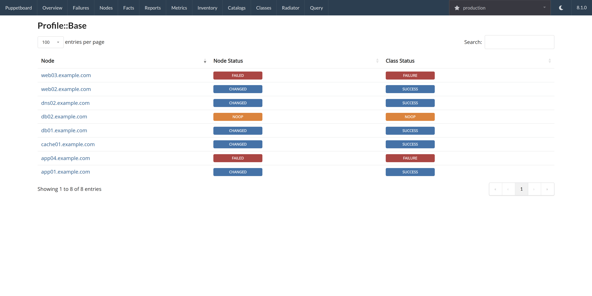
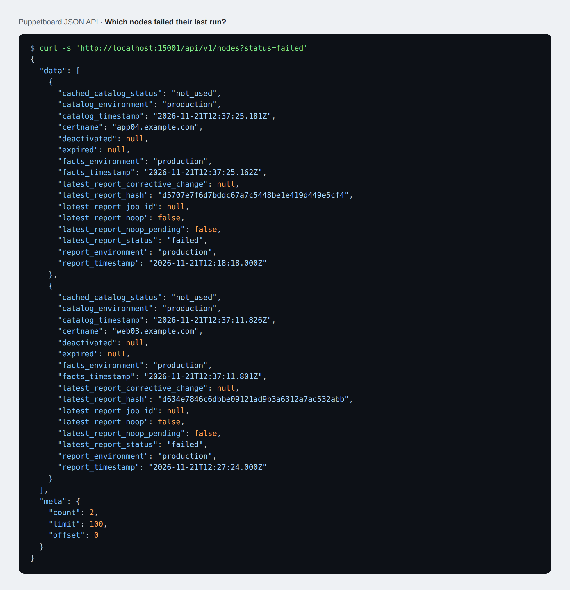
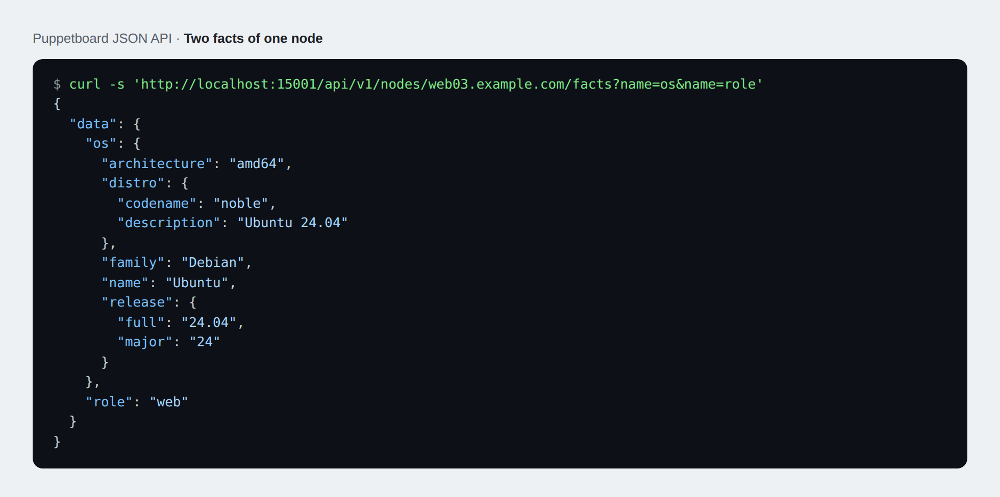
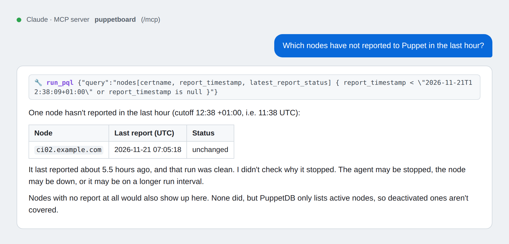

# Screenshots

Taken from a test PuppetDB with made-up nodes.

## Web interface

* Overview

* Nodes view, all active nodes

* Single node

* Report view

* Failures view, the errors of all failing nodes

* Facts view

* Single fact, with graphs

* All nodes that have this fact with that value

* Query view, results as table

* Query view, results as JSON

* Metrics view

* Single metric

* Inventory view

* Classes view, group the resource events of the last reports by Puppet class

* Class view, the nodes with at least one resource event in a given class

* Radiator view, for a wall display

## JSON API

Real `curl` calls and their answers, see [API.md](API.md#examples).

## MCP server

Claude Code connected to `/mcp`, with the tool calls it made, see [MCP.md](MCP.md#examples).

