# Screenshots

* Overview / Index / Homepage

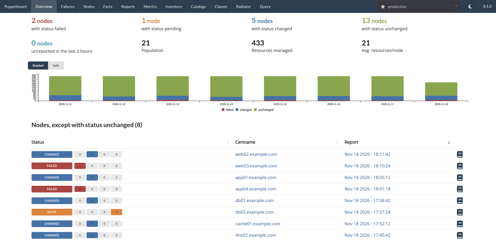

* Nodes view, all active nodes

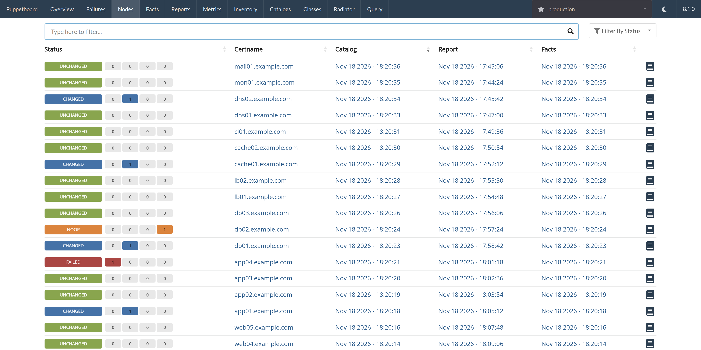

* Single node page / overview

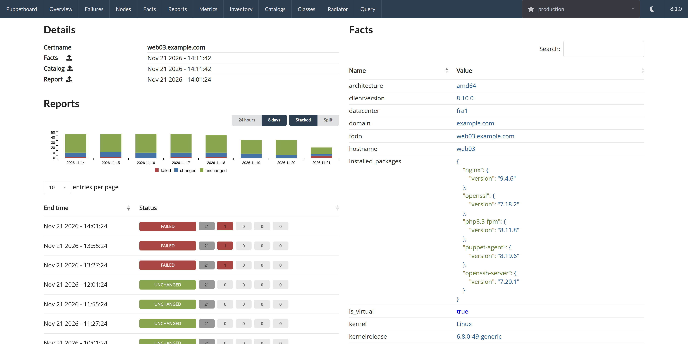

* Report view

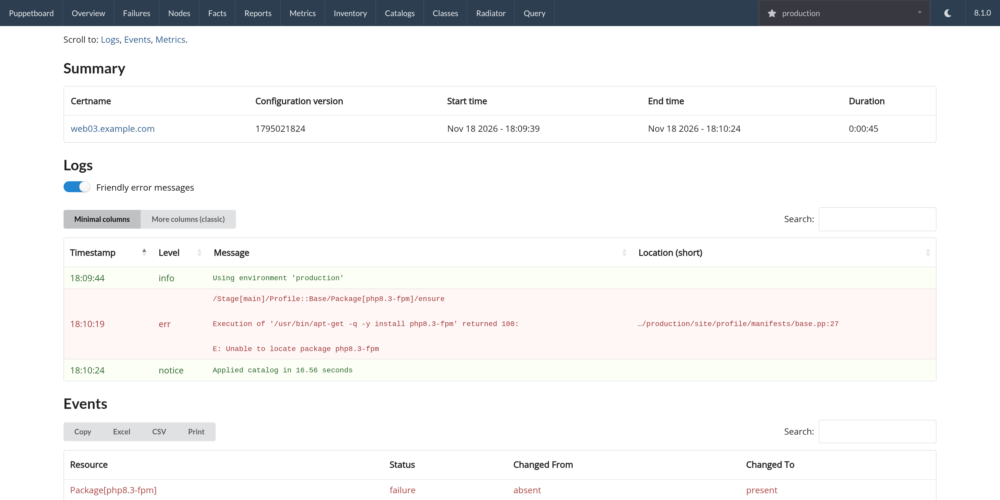

* Failures view, the errors of all failing nodes

* Facts view

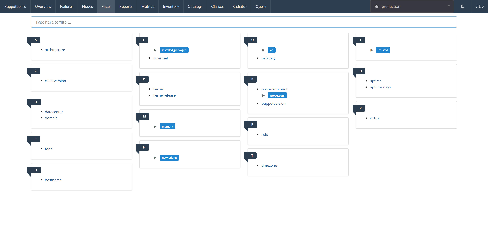

* Single fact, with graphs

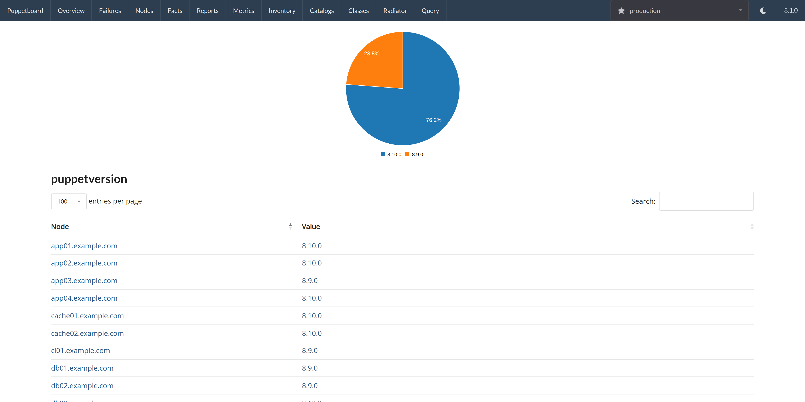

* All nodes that have this fact with that value

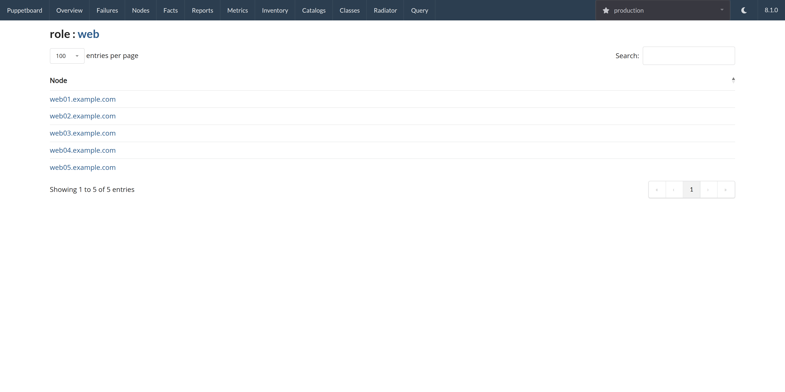

* Query view - results as table

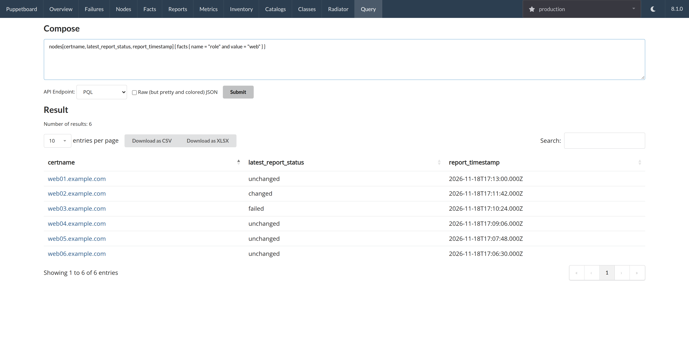

* Query view - results as JSON

* Metrics view

* Single metric

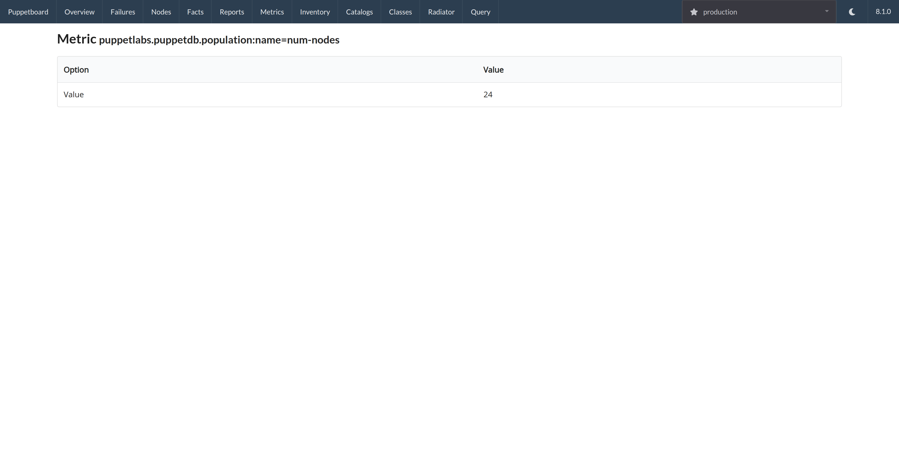

* Inventory view

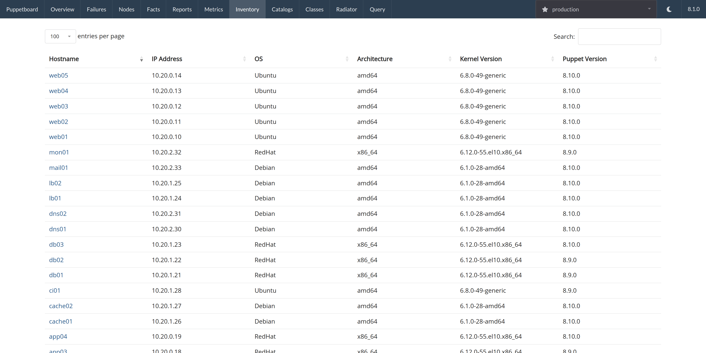

* Classes view, group the resource events of the last reports by Puppet class

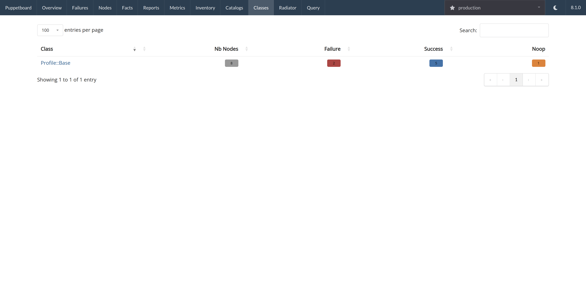

* Class view, list the nodes with almost one resource event for a given class

* Radiator view, for a wall display

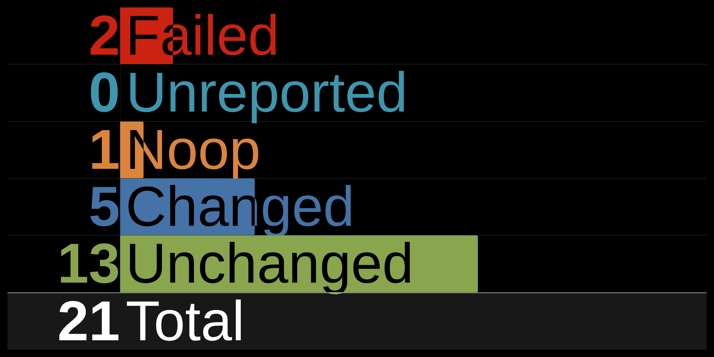
